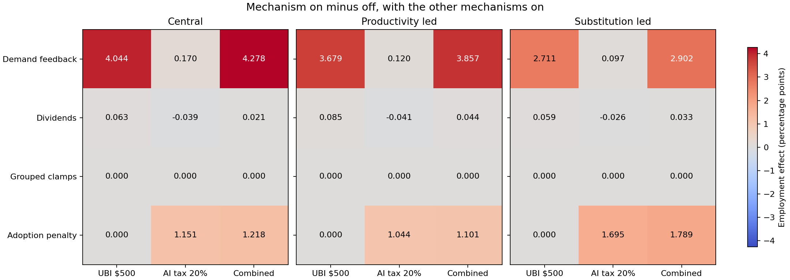

# E2 mechanism experiment

The frozen version 1.0 design produced 192 runs, 2,112 annual rows and
384 matched on-minus-off contrasts. Independent checks reconstructed
all trajectories, paired summaries and mechanism contrasts.

All 192 runs remain in domain. No grouped clamp activated in this E2
design; its on-minus-off effects are zero here. Boundary behavior is
reserved for the wider assumption grids and refinement experiments.

With all mechanisms on, mean employment differences from the matched
no-policy run over years 1–10 are:

| Economic layer | UBI $500 | AI tax 20% | Combined |
| --- | ---: | ---: | ---: |
| Central | 4.0439 | 1.1266 | 5.2346 |
| Productivity led | 3.6785 | 1.0201 | 4.7569 |
| Substitution led | 2.7115 | 1.6723 | 4.4773 |

Values are percentage points. UBI has zero employment effect when demand
feedback is off. Restoring feedback gives UBI effects of 2.7115–4.0439
percentage points across these layers with the other mechanisms on.
Tax-induced adoption suppression accounts for 1.0437–1.6953 percentage
points of the tax-only policy effect under the same conditional comparison.
Dividend contrasts are smaller and vary by policy. These conditional
ablations retain interactions and should not be summed as a decomposition.

Source tables are `outputs/mechanisms/summary.csv`, `contrasts.csv` and
`figure_inputs.csv`. Complete configurations and hashes are in `manifest.json`;
all annual traces are in `annual.csv.gz`. `validation.json` records the
independent reconstruction. All source configurations, including the
zero-effect cases, remain in the saved results.

Run `python -m research.verify_mechanisms` to check the saved results and
`python -m research.analyze_mechanisms` to rebuild this report and figure.
To recompute E2, preserve or move the existing result directory first;
`python -m research.run_mechanisms` refuses to overwrite completed runs.
