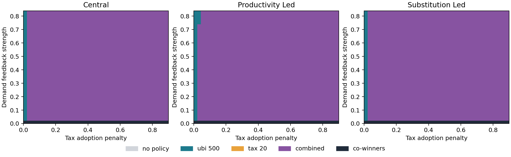
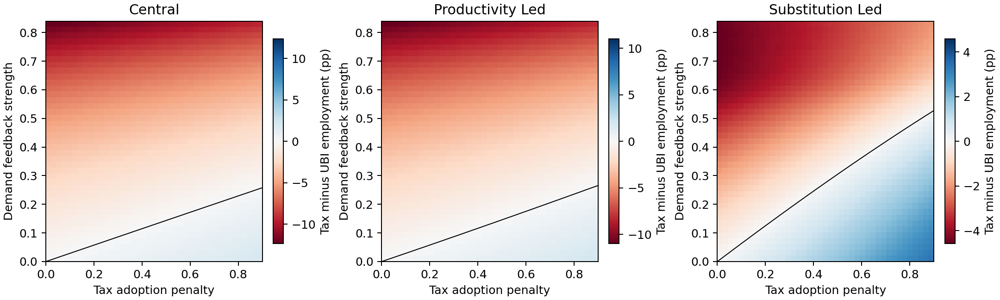
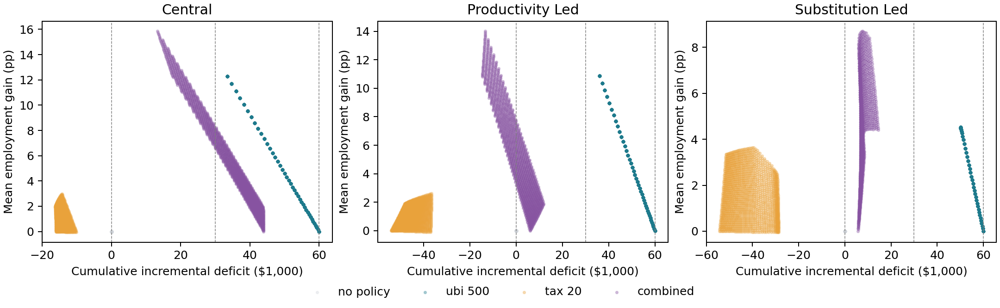

# E3-E5 policy grids, boundaries and fiscal constraints

The frozen protocol 1.0 was executed without changing its policy inputs, grid ranges, ranking tolerance or budgets. Independent validation passed. These are deterministic artificial stress tests; node counts describe these grids, not real-world probabilities.

## E3: policy comparisons

The 41 by 41 grids contain 20,172 runs and 221,892 annual observations across three economic layers and four policies. All six policy pairs and all co-winners are retained.

Invalid numeric runs: 0; out-of-domain paired runs: 0; nonphysical paired runs: 0; runs with any clamp: 1444.

| Layer | Policy | Minimum employment gain (pp) | Maximum employment gain (pp) |
| --- | --- | ---: | ---: |
| central | no_policy | 0.000000 | 0.000000 |
| central | ubi_500 | 0.000000 | 12.278766 |
| central | tax_20 | -0.059194 | 2.988034 |
| central | combined | 0.000000 | 15.859546 |
| productivity_led | no_policy | 0.000000 | 0.000000 |
| productivity_led | ubi_500 | 0.000000 | 10.878006 |
| productivity_led | tax_20 | -0.108789 | 2.617027 |
| productivity_led | combined | 0.000000 | 14.010772 |
| substitution_led | no_policy | 0.000000 | 0.000000 |
| substitution_led | ubi_500 | 0.000000 | 4.532515 |
| substitution_led | tax_20 | -0.046285 | 3.639469 |
| substitution_led | combined | 0.000000 | 8.707345 |

## E4: sampled boundaries and resolution checks

The nested 21, 41 and 81 grids use 78,732 unique configurations. Shared coordinates reuse identical evaluations; their comparison checks membership and classification consistency, not an independent convergence proof. All 7,689 shared-coordinate checks agree.

| Resolution | Strict sign-change edges | Edges touching sampled ties | Same-sign edges | Ineligible edges |
| ---: | ---: | ---: | ---: | ---: |
| 21 | 204 | 270 | 14646 | 0 |
| 41 | 411 | 510 | 58119 | 0 |
| 81 | 828 | 990 | 231462 | 0 |

Every candidate edge is saved in boundaries.csv; 0 brackets remain unresolved. Strict brackets are bisected to width at most 1e-6 or 30 iterations. Sampled ties are points or tie-touching edges, not proofs of unique roots. Same-sign edge counts retain no-crossing cases. These scans do not certify the continuous parameter domain.

## E5: fiscal feasibility

Cumulative incremental deficit is the negative sum of candidate-minus-baseline annual balances over years 1-10. Negative values mean incremental savings. At each E3 node, all eligible policies meeting each 0, 30 or 60 thousand-dollar cap are compared by mean employment gain; ties remain co-winners. Dominated and infeasible policies remain in fiscal.csv.

| Layer | Cap ($1,000) | Policy | Feasible nodes | Co-winner nodes |
| --- | ---: | --- | ---: | ---: |
| central | 0 | combined | 0 | 0 |
| central | 0 | no_policy | 1681 | 41 |
| central | 0 | tax_20 | 1681 | 1641 |
| central | 0 | ubi_500 | 0 | 0 |
| central | 30 | combined | 564 | 564 |
| central | 30 | no_policy | 1681 | 29 |
| central | 30 | tax_20 | 1681 | 1089 |
| central | 30 | ubi_500 | 0 | 0 |
| central | 60 | combined | 1681 | 1641 |
| central | 60 | no_policy | 1681 | 1 |
| central | 60 | tax_20 | 1681 | 41 |
| central | 60 | ubi_500 | 1681 | 41 |
| productivity_led | 0 | combined | 735 | 735 |
| productivity_led | 0 | no_policy | 1681 | 19 |
| productivity_led | 0 | tax_20 | 1681 | 928 |
| productivity_led | 0 | ubi_500 | 0 | 0 |
| productivity_led | 30 | combined | 1681 | 1681 |
| productivity_led | 30 | no_policy | 1681 | 1 |
| productivity_led | 30 | tax_20 | 1681 | 41 |
| productivity_led | 30 | ubi_500 | 0 | 0 |
| productivity_led | 60 | combined | 1681 | 1636 |
| productivity_led | 60 | no_policy | 1681 | 1 |
| productivity_led | 60 | tax_20 | 1681 | 41 |
| productivity_led | 60 | ubi_500 | 1681 | 46 |
| substitution_led | 0 | combined | 0 | 0 |
| substitution_led | 0 | no_policy | 1681 | 41 |
| substitution_led | 0 | tax_20 | 1681 | 1641 |
| substitution_led | 0 | ubi_500 | 0 | 0 |
| substitution_led | 30 | combined | 1681 | 1681 |
| substitution_led | 30 | no_policy | 1681 | 1 |
| substitution_led | 30 | tax_20 | 1681 | 41 |
| substitution_led | 30 | ubi_500 | 0 | 0 |
| substitution_led | 60 | combined | 1681 | 1641 |
| substitution_led | 60 | no_policy | 1681 | 1 |
| substitution_led | 60 | tax_20 | 1681 | 41 |
| substitution_led | 60 | ubi_500 | 1681 | 41 |

## Reproduction and evidence

After a fresh checkout, first run `python -m research.restore_grid_evidence`. Large files are reassembled byte-for-byte from the included repository parts with SHA256 checks. All five files were restored and checked in a new directory; evidence is in `outputs/policy_grids/restoration_validation.json`.

Run `python -m research.verify_policy_grids` to independently reconstruct every grid summary from saved annual traces, check hashes and inputs, replay selected grid paths and all reported boundary endpoints, enumerate all candidate edges, and verify paired signs, ties and budget winners. Run `python -m research.analyze_policy_grids` to rebuild these figures and count tables. To recompute, preserve or move outputs/policy_grids first and run `python -m research.run_policy_grids`; existing results are protected.

The manifest hashes the frozen protocol, model, runner, verifier, analysis source and evidence files. Complete resolved inputs are in configs.jsonl.gz; refinement evaluations have separate configuration and annual streams. summary.csv contains all three resolution memberships.
